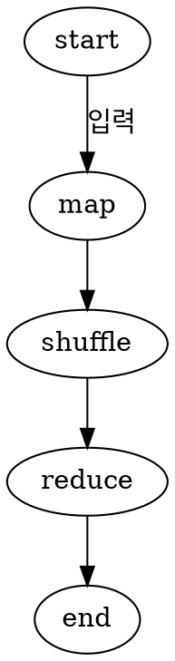

## 빅데이터 표현 기술의 개요
- 특정 기준에 따라 분석한 데이터의 특징이나 분석 결과를 분석가·사용자가 쉽게 이해하도록 그림이나 그래프로 표현하는 기술
- 예: 스프레드시트 프로그램
- 빅데이터 분석에서는 표현 단계가 가장 중요한 기술 분야로 취급받음

## 주요 표현 기술
| 기술 | 최초 개발 | 최초 공개 | 주요 기능 |
|---|---|---|---|
| Tag Cloud | D. Coupland | 1995 | 태그 연관성에 따른 빈발도·관계 분석 |
| Gephi | M. Bastian | 2008 | 데이터를 네트워크 형태로 생성해 표현 |
| GraphViz | AT&T | 1988 | 흐름도·트리 다이어그램 생성 |
| Processing | MIT Media Lab | 2001 | 그래픽 디자인을 위한 프로그래밍 언어 |
| Fusion Tables | 구글 | 2009 | 대용량 데이터를 표현하는 온라인 서비스 |
| Tableau | P. Hanrahan | 2003 | 시각적 분석·리포팅 도구 |
| TinkerPop | A. Averbuch | 2009 | 그래프 처리 통합 서버형 시스템 |
| Clustergram | M. Schonlau | 2002 | 계층적 군집화에 적합한 표현 |
| Spatial Information Flow | - | - | 특정 정보를 기준으로 데이터 흐름 표현 |

## 태그클라우드(Tag Cloud)
- 메타데이터에서 얻은 태그를 중요도·빈발도·인기도 등 주제에 따라 분석해 시각적으로 늘어놓은 것
- 대부분 웹 페이지나 이미지로 나타내며, 보통 태그가 2차원 표 같은 형태로 배치
- 하나의 연결에 연관된 태그가 얼마나 많고, 그 태그들이 어떤 종류인지 잘 보여 줌
- 대표적 용도는 각 태그의 인기도 표시
  - 예: Last.fm은 사용자가 어떤 음악가·장르를 자주 듣는지 분석해 태그 클라우드를 생성

## 게피(Gephi)
- 정제·가공하지 않은 그래프 데이터를 네트워크 형태로 만들어 시각화하는 오픈소스 Java 응용
- 소셜 네트워크 정보를 쉽게 이해하도록 도와주며, LinkedIn 데이터 표현에 많이 활용
- 표현에 필요한 변수를 구성하려고 여러 알고리즘을 사용했고, 사용자가 데이터·노드 위치를 자유롭게 수정·조절
- 수정할 데이터나 노드 위치가 많아도 윈도우 GUI로 빠르게 수정하고, 기본적으로 많이 쓰는 그래프 구성을 제공
- 표현 결과를 미리보기 탭에서 확인하고, 툴킷 라이브러리 함수로 문서를 작성
- 예: Oracle OpenWorld 2011에서 관심 세션·세션 좌장과의 친분을 기준으로 투표 결과를 네트워크 그래프로 표현

## 그래프비즈(GraphViz)
- AT&T 연구소가 DOT 스크립트 언어로 다이어그램을 그리려고 만든 오픈소스 프로그램, CPL(Common Public License) 사용
- 데이터를 기반으로 다이어그램을 그리는 명령어 라인 네트워크 그래프 시각화 툴
- 일반적인 목적의 흐름도나 트리 그리기에 적합
- 결과 그래프는 다른 툴보다 단순·투박하지만, 효과적으로 다듬는 다양한 옵션을 제공
- 다른 소프트웨어에서 라이브러리로 사용 가능, DOT 언어로 그래프를 정의하고 필터로 여러 이미지 포맷 생성
- 예: 40개국 이상 웹사이트 300여 개 간 네트워크 구성을 다이어그램으로 표현

- 위처럼 DOT로 노드와 간선을 적으면 레이아웃은 도구가 계산한다

## 프로세싱(Processing)
- 기존 DBN(Design By Number) 기반으로 만든 프로그래밍 언어
- DBN은 디자이너·아티스트의 프로그래밍 접근성을 높이려고, 프로그래밍·계산 과정의 난해함을 최소화해 몇 줄로 이미지를 만들도록 고안한 소프트웨어
- 디자이너에게 가장 알려진 그래픽 프로그래밍 언어이며, 관련 라이브러리·예시·문서가 많아 원하는 정보를 얻기 쉬움
- 시각화 도구로 구성된 JavaScript 프레임워크 Protovis의 영향 아래, 바·라인 그래프, 포스-디렉티드 네트워크 구성 등 다양한 기능을 제공
- 시각화 템플릿 툴 중 인터페이스 수준이 상당히 높은 편

## 도구 비교
| 도구 | 표현 대상 | 사용 방식 | 강점 |
|---|---|---|---|
| Tag Cloud | 태그 빈도 | 웹 페이지·이미지 | 인기도를 한눈에 |
| Gephi | 네트워크 그래프 | GUI | 대화형 편집, 소셜 분석 |
| GraphViz | 흐름도·트리 | DOT 스크립트 | 자동 레이아웃, 라이브러리 제공 |
| Processing | 창작·커스텀 시각화 | 코드 | 표현 자유도, 예제 풍부 |

## 정리
- 태그 클라우드는 "무엇이 많은가", 게피·그래프비즈는 "무엇이 어떻게 연결되었는가", 프로세싱은 "어떻게 그릴 것인가"를 담당
- 도구를 고를 때는 데이터 형태(태그/네트워크/흐름)와 조작 필요성(GUI/스크립트/코드)을 기준으로 보면 된다
